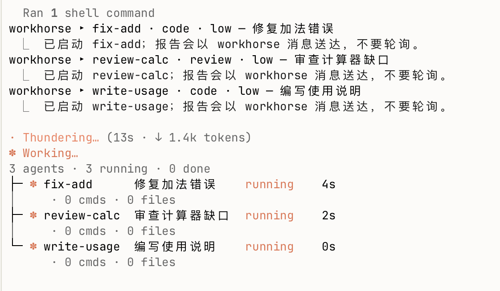

# workhorse

> A Claude Code mod that hands coding, review and ops work to Codex as background subagents.

`workhorse` 是一个 Claude Code 插件，用于将编码实现、代码审查和运维操作以子代理方式委托给后台的 Codex 处理。Claude 负责撰写四段式 brief 并把关 diff 与验收，Codex 在后台异步执行，任务完成后将报告送回会话，避免轮询与等待。

<p align="center"></p>

# 仓库内容

- `hooks/register.ts`：注册 `mcp__workhorse__run` 工具、权限拦截、`/workhorse-kill` 命令与实时状态面板，按会话隔离状态。
- `hooks/lib.ts`：负责 brief 拼装、前置校验（lint）、参数解析、终端排版与中文文案。
- `bin/workhorse`：独立的命令行执行引擎，负责环境隔离、规则块附加、Codex 进程管理、事件记录、生成报告与 Git worktree 维护。
- `prompts/blocks.md`：附加至 Codex 任务的四段精简规则（`action_safety`、`verification_loop`、`default_follow_through_policy`、`compact_output_contract`）。
- `skills/workhorse/SKILL.md`：指导 Claude 何时派活、如何书写 brief 以及如何审查结果的 Skill 定义。

## 免责声明

**本插件会在后台调用 Codex 执行终端命令与文件改动。** 虽然具备权限分级与看门狗提醒机制，但在将代码合并到主分支前，仍应始终核对 diff 并自行运行验收命令。请在适合自身环境与风险要求的场景下使用。

# 在 Claude Code 中试用

依赖环境：
- Claude Code v2.1.287 或更新版本（已在 v2.1.296 测试）
- Codex CLI，已登录且支持 `codex exec --json`（已在 0.162.1 测试）
- `bash`、`git`、`jq`、`perl`；macOS 或 Linux

在 Claude Code 提示框中执行以下命令添加市场并安装：

```
/plugin marketplace add guojunjie0614-cyber/workhorse
/plugin install workhorse@workhorse
```

也可以在系统终端中运行等价命令：

```bash
claude plugin marketplace add guojunjie0614-cyber/workhorse
claude plugin install workhorse@workhorse
```

安装后在会话中执行 `/reload-plugins`，或重启会话以加载更新。

### 自然语言使用示例

安装完成后，在会话中直接向 Claude 提出修改需求：

> 修复 parser.py 中遇到 None 时的解析异常，验收命令是 pytest tests/test_parser.py。

Claude 会自动提取上下文并拼装 brief，通过后台子代理指派给 Codex 执行。

### 最小调用示例

插件通过 `mcp__workhorse__run` 工具派发任务，最小调用如下：

```json
{
  "name": "fix-parser",
  "title": "修复解析器空值",
  "goal": "修复 parser.py 中遇到 None 时的解析异常",
  "context": "parser.py parse() 函数在输入为空时抛出 AttributeError",
  "done_when": "pytest tests/test_parser.py"
}
```

该工具调用后立即返回，Codex 在后台运行；完成后报告会自动送回对话，提醒 Claude 执行指定的验收命令。

# 任务模式与调用字段

### 三种模式

- `code`（默认）：仅允许写入目标目录，适合单点代码实现与 bug 修复。
- `review`：只读模式，用于定位根因和排查缺陷，不修改任何文件。
- `ops`：运维模式，允许访问仓库外路径与远程机器；启动及续做 ops 任务前会向用户发起确认。

### 调用字段说明

| 字段 | 必填 | 说明 |
|---|---|---|
| `name` | 新任务必填 | 英文短横线命名（如 `fix-parser`，匹配 `^[a-z][a-z0-9-]*$`）；续做时可省略 |
| `title` | 是 | 6–12 个中文字（至多 24 列宽），面板完整显示，如“修复解析器空值” |
| `goal` | 是 | 本次具体的单一改动目标 |
| `context` | 是 | 关联的文件、函数、错误证据及路径 |
| `constraints` | 否 | 仅属于本任务特有的限制 |
| `done_when` | 是 | 一条具体的单项验收命令 |
| `mode` | 否 | `code`（默认）、`review`、`ops` |
| `dir` / `worktree` | 否 | 工作目录；或指定 worktree 名称从 HEAD 建立分支并行 |
| `resume` / `to_code` | 否 | 在原线程续做；将 review 结论转为修复代码 |
| `effort` / `model` | 否 | 覆盖默认的推理强度和模型 |

# 看门狗提醒

看门狗负责被动监控任务状态，只发提醒、不杀进程，每类提醒对单个任务仅触发一次：

| 情况 | 触发条件（设置项） | 默认阈值 |
|---|---|---|
| 无输出 | 无命令运行且无新事件间隔超过阈值（`stall_minutes`） | 10 分钟 |
| 命令跑太久 | 单条命令持续运行超过阈值（`command_minutes`） | 20 分钟 |
| 原地打转 | 相同命令与退出码连续出现且未改动文件（`repeat_limit`） | 3 次 |
| 测试跑太多 | 测试类命令执行次数达到上限（`max_tests`） | 2 次 |
| token 过多 | 单个任务家族各轮次累计 token 达到阈值（`family_tokens_warn`） | 1000000 |

需要中断任务时，可在 Claude Code 中输入 `/workhorse-kill [name]`，或在终端执行 `workhorse -k [name]`。被终止的任务在面板上标记为 `cancelled`。

# 命令行引擎

`bin/workhorse` 是独立可用的底层引擎，也可以软链接到 `PATH`（例如 `ln -s ~/workhorse/bin/workhorse ~/.local/bin/workhorse`）：

| 命令 | 说明 |
|---|---|
| `workhorse -C dir <<'EOF' … EOF` | 在指定目录启动 code 任务，brief 从 stdin 读入 |
| `workhorse --review` / `--ops` | 启动只读诊断或运维模式任务 |
| `workhorse -w name` | 新建 worktree `<repo>-name`（分支 `workhorse/name`）并执行 |
| `workhorse -r [name] [--code]` | 在原 Codex 线程上续做（`--code` 对应转为代码修复） |
| `workhorse -l` | 查看近期任务列表及结果概况 |
| `workhorse -t [name]` | 查看最近执行的命令、测试次数与最新输出间隔 |
| `workhorse -s [name …]` | 输出任务状态 JSON，供外部或插件读取 |
| `workhorse -k [name]` | 终止指定任务及其子进程 |
| `workhorse --clean name` | 合并后清理对应 worktree 和分支（未合并或存在未提交改动时拒绝清理） |
| `workhorse -h` | 显示命令行帮助与当前配置 |

任务记录保存在 `~/.cache/workhorse/<name>/`（包括 `prompt.md`、`events.jsonl`、`codex.log`、`final.md`、`report.txt`、`session.txt` 等），超出 `keep_days` 后自动清理。

# 设置项

可以在 `/plugin configure workhorse@workhorse` 中配置，或写入 `~/.config/workhorse/config`（格式为 `WORKHORSE_XXX=值`）及环境变量：

| 设置项 | 引擎环境变量 | 默认值 | 说明 |
|---|---|---|---|
| `model_code` / `model_review` / `model_ops` | `WORKHORSE_MODEL_*` | `gpt-6-astra` / `gpt-6-astra` / `gpt-6.1-sol` | 各模式默认模型 |
| `effort_code` / `effort_review` / `effort_ops` | `WORKHORSE_EFFORT_*` | `medium` / `high` / `high` | 各模式推理强度 |
| `fast_match` | `WORKHORSE_FAST_MATCH` | `*sol*` | 匹配的模型走 Fast 档，默认 high 强度 |
| `disable_mcp` | `WORKHORSE_DISABLE_MCP` | `node_repl` | 禁用的 MCP 服务 |
| `allow_ops` | `WORKHORSE_ALLOW_OPS` | `true` | 是否允许 ops 模式 |
| `stall_minutes` | - | `10` | 无输出提醒阈值（分钟） |
| `command_minutes` | - | `20` | 单命令超时提醒阈值（分钟） |
| `repeat_limit` | - | `3` | 重复命令触发提醒次数 |
| `max_tests` | - | `2` | 测试类命令执行上限提醒 |
| `family_tokens_warn` | - | `1000000` | 累计 token 消耗提醒阈值 |
| `keep_days` | `WORKHORSE_KEEP_DAYS` | `14` | 任务历史记录保留天数 |
| `skip_skills` | `WORKHORSE_SKIP_SKILLS` | `karpathy-guidelines,code-review,diagnosing-bugs,tdd` | Codex 忽略的通用流程技能 |
| `banned_phrases` | - | `baseline,全量测试,full test suite,前后对比,before/after` | brief 禁止包含的门禁词汇（逗号分隔） |
| `hide_codex_rescue` | - | `true` | 安装官方 Codex 插件时隐藏 `codex:codex-rescue` |

# 工作原理

```
Claude ──mcp__workhorse__run──▶ hooks/register.ts ──lint / 权限──▶ bin/workhorse --detach
                                     ▲                                   │
                                     │ 状态（-s，事件变化即刷新）          ▼
                              面板 / 提醒 / 完成通知  ◀── events.jsonl ◀── codex exec --json
```

- `hooks/register.ts`：注册工具接口与状态面板，维护会话级任务状态，每 30 秒轮询或随任务新事件即时刷新。
- `hooks/lib.ts`：在任务派发前执行 brief lint 检查，若缺少 `done_when`、标题不合规或包含门禁词则直接拦截。
- `bin/workhorse`：为 Codex 构建执行参数与规则块，通过 `codex exec --json` 启动子进程并输出事件流。
- 完成通知确认送达至 Claude 会话后才删除任务标记；Codex 线程 ID 在启动时持久化记录，保证异常中断后仍可续做。

# 开发

运行校验与测试：

```bash
claude plugin validate . --strict
claude plugin test
```

测试用例位于 `hooks/workhorse.test.ts`，使用 Claude Code 自带的 mod 测试机制模拟状态与进程调用，不消耗 token。

# 许可证

[MIT](LICENSE)
